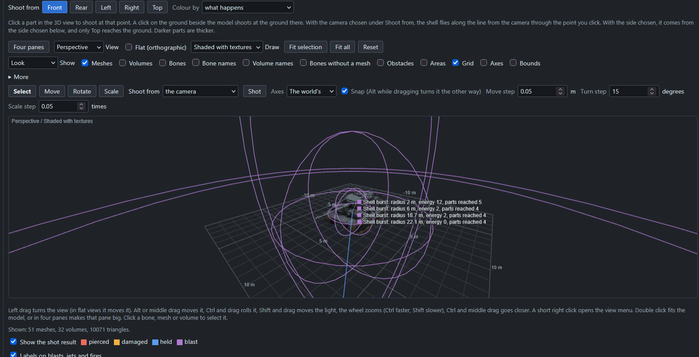
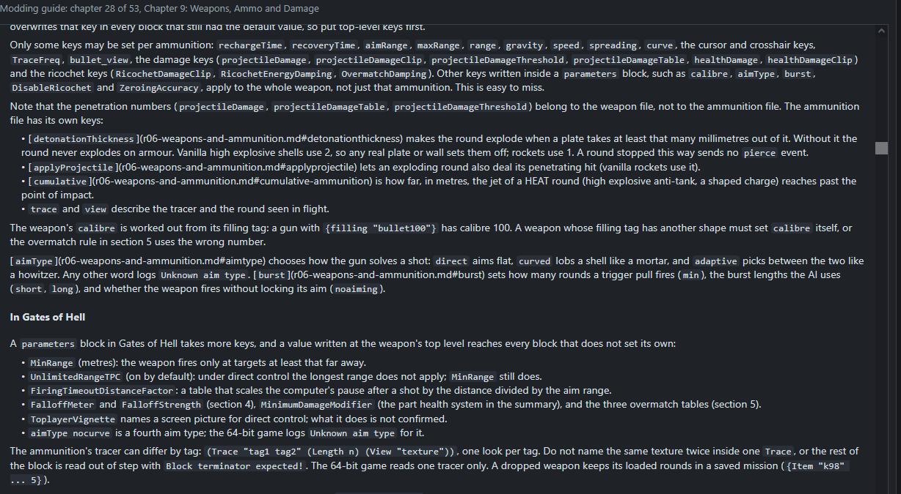
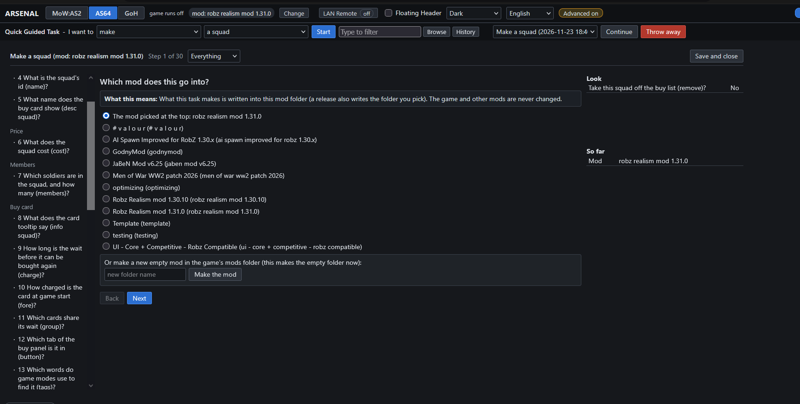
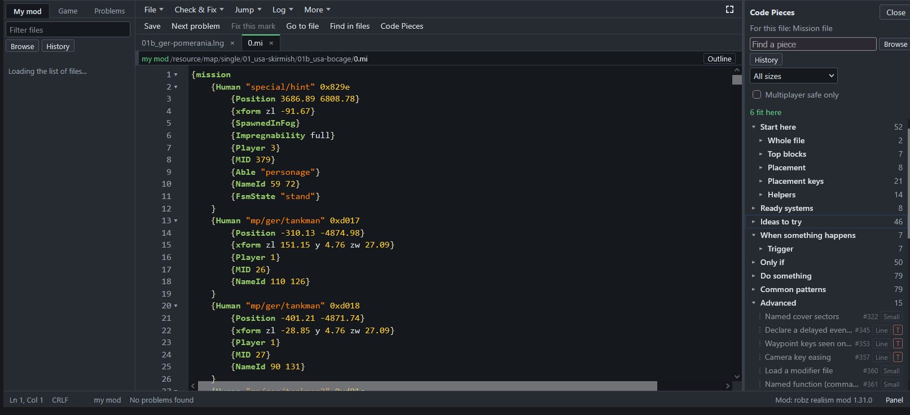
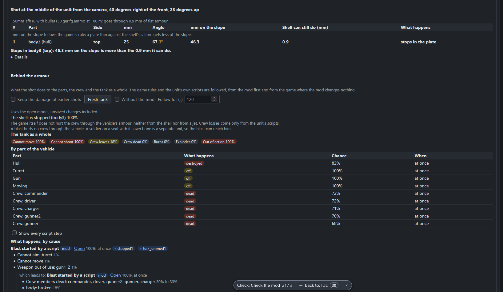
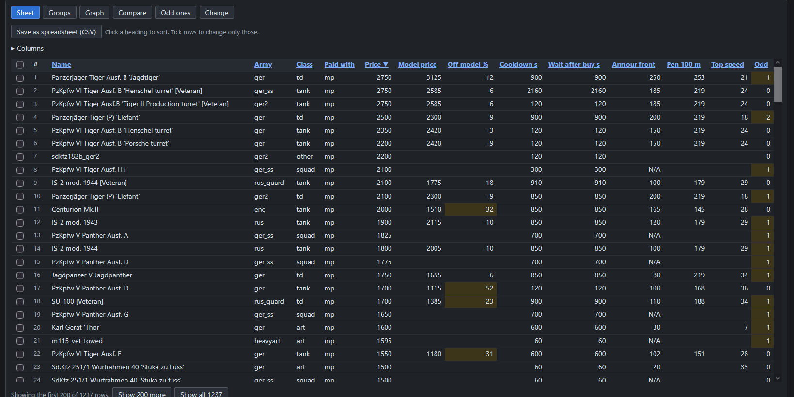
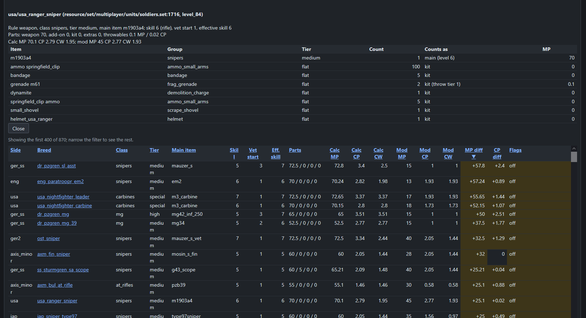
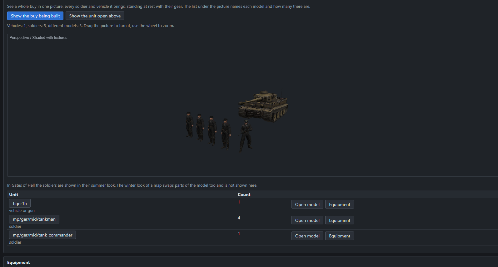
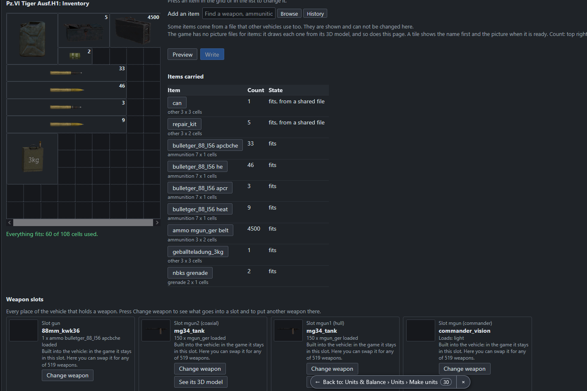

# ARSENAL

A.R.S.E.N.A.L (All-in-one Resource SDK for Engine Assets & Levels): modding tools for Men of War: Assault Squad 2, its 64-bit build AS64 and Gates of Hell.

This is a 3rd party tool that was made largely with AI. Use at your own risk.

**Open Beta - active development**



## Features

### Information Unleashed

- The most comprehensive modding documentation ever offered for the GEM engine.
- Dozens of community tools indexed.
- 9000 indexed guides and questions from the community over the decades.
- 1819 first and second hand historical technical documents from various nations across the Second World War. The current complement contains mostly land weapons and doctrine.



### Easy access

- Quick task system allowing anybody to quickly and easily get into modding.



- An Integrated Development Environment (IDE) that contains almost 1000 pre-formatted code blocks, engine specific syntax highlighting, extensive error catching, pak file and vanilla searching, including what files have been overwritten.



### Unparalleled Quality Control

- Assisted and some automated fixing of every possible issue the engine would ignore or crash on.
- Assisted fixing of clashing files when multiple mods are enabled.
- Automated log reading.
- Batch automated entity testing.

### Other Assisted Workflows

- Play sounds exactly how they sound in game at any condition in the IDE.
- Model adjuster with built in ballistic and explosive simulator exactly as the game sees it. Covers vanilla and modded scripting as well.



- Map viewer, stylized and automatic preview generators, balance assessment tools.
- Automated basic mission generator.
- Gamemode adjuster.
- AI purchase logic, and control modifiers which can be modified by historical doctrine assessments.
- Targeting AI made simple.
- Advanced mission scripting assister to help the AI even in multiplayer.
- Multiplayer unit balancing toolkit, including per breed pricing based on stats and equipment.





- Unit icon generator.
- 3D editable unit views of buys with their equipment and simplified item chance.





- Version difference checker.
- Claude MCPs and Skills.

and much more.

## Start

Needs Node.js 18 or newer; the installer sets it up by itself. Game installs are read only; tools write only to a mod folder you name.

```bash
node tools/gui/gui.js
```

Then open the address it prints.

## What is in the repository

- `tools/` node tools: linters, mod creation, porting, packing, the test loop. Start with `tools/QUICKSTART.md`.
- `tools/gui/` the ARSENAL window.
- `tools/mcp/` MCP servers for Claude (`.mcp.json`), `.claude/skills/` the skills that route a task to the tools.
- `tools/dist/`, `tools/installer/` build the download package and the installers for Windows, Linux and macOS. Start with `BUILDING.md`; every option is in `tools/dist/README.md`.
- `guide/` the modding guide.
- `ww2sources/` the historical documents the window searches.

## Licence

Apache License 2.0, see `LICENSE`, `NOTICE` and `LICENSING.md`. Credits: `CREDITS.md`. Game names and game data belong to their owners. Mods shown in the pictures belong to their authors.
