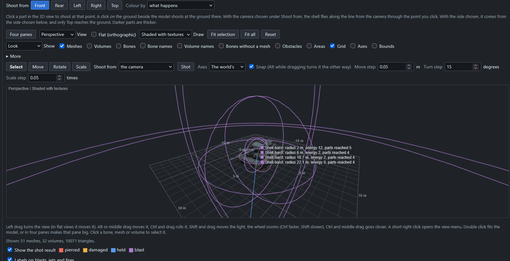
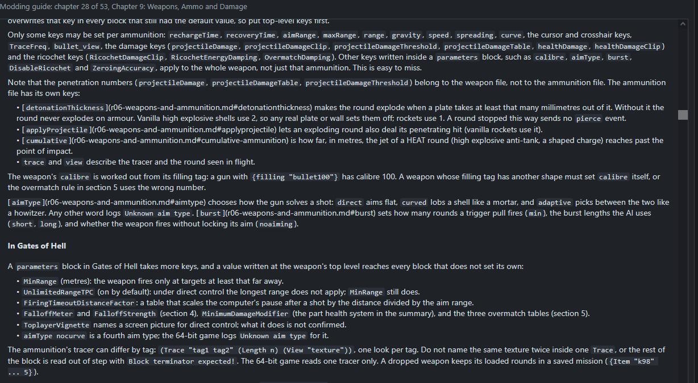
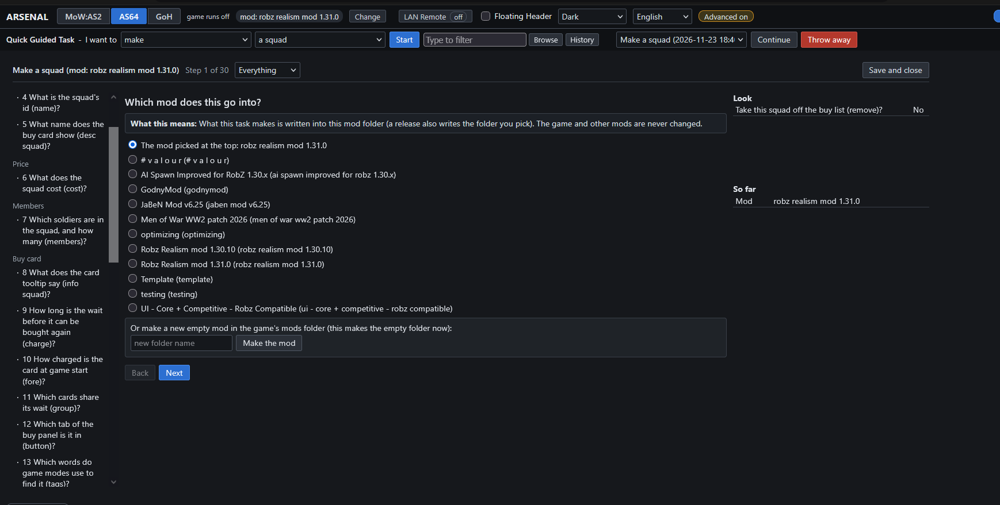
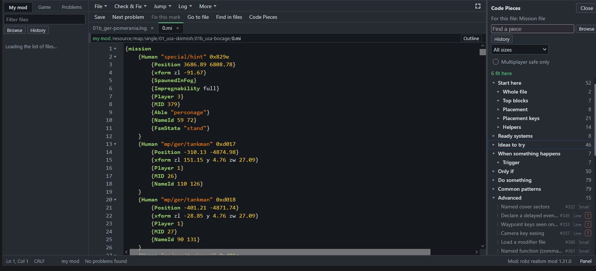
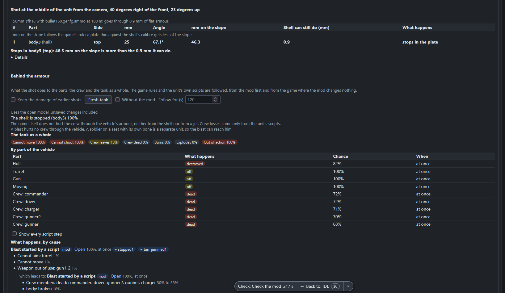
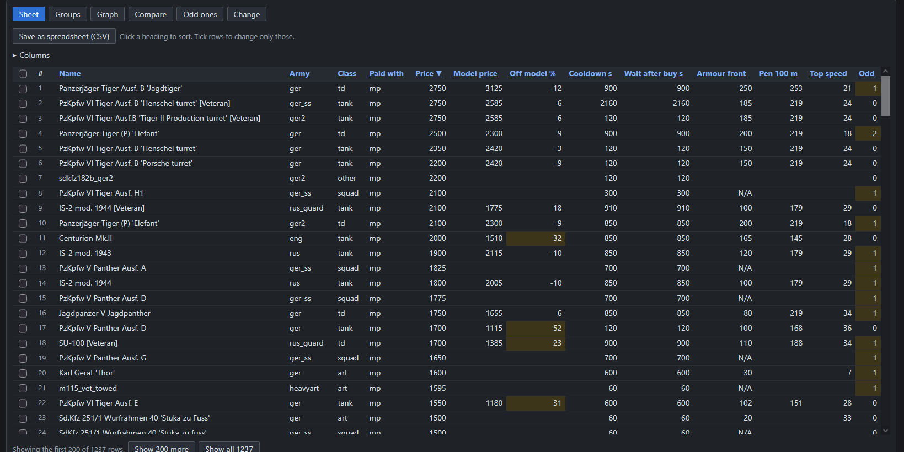
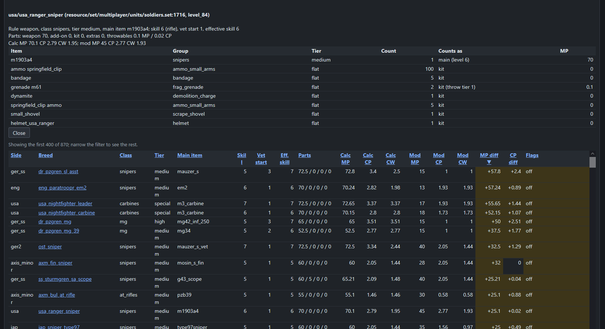
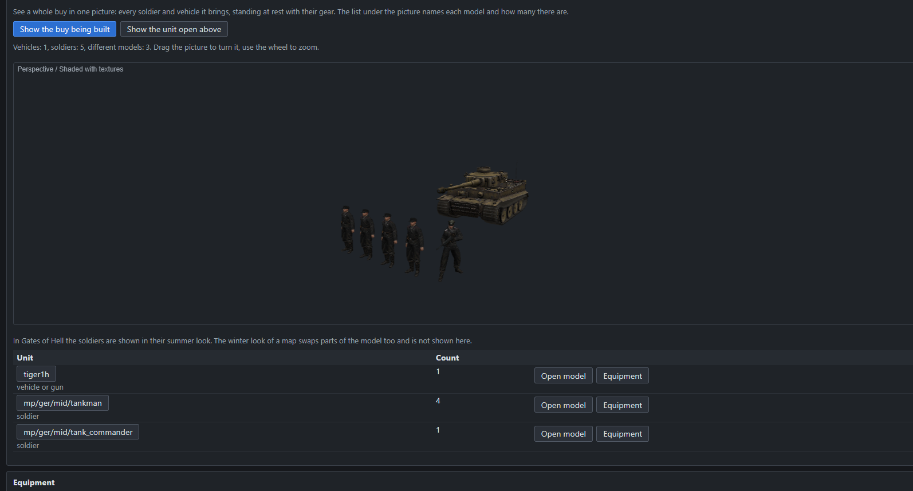
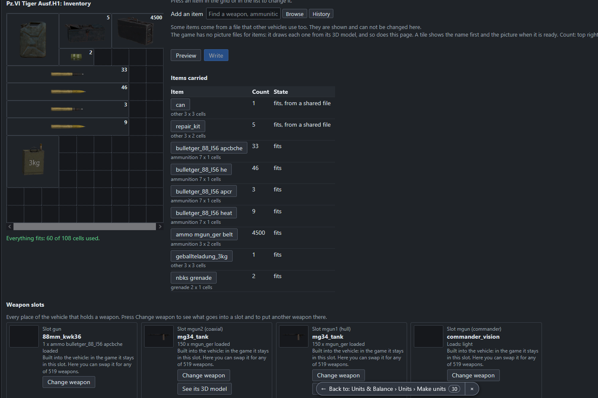

# ARSENAL

[English](README.md) | **Русский** | [Українська](README.uk.md) | [中文](README.zh.md)

A.R.S.E.N.A.L (All-in-one Resource SDK for Engine Assets & Levels): инструменты для создания модов к Men of War: Assault Squad 2, её 64-битной сборке AS64 и Gates of Hell.

Это сторонний инструмент, созданный в основном с помощью ИИ. Используйте на свой страх и риск.

**Открытая бета - идёт активная разработка**



## Возможности

### Информация без ограничений

- Самая полная документация по моддингу из когда-либо выходивших для движка GEM.
- Каталог из десятков инструментов сообщества.
- 9000 проиндексированных руководств и вопросов сообщества за десятилетия.
- 1819 исторических технических документов из первых и вторых рук от разных стран времён Второй мировой войны. Сейчас в подборке в основном наземное вооружение и доктрины.



### Лёгкий старт

- Система быстрых задач, с которой любой может быстро и легко начать делать моды.



- Интегрированная среда разработки (IDE): почти 1000 готовых блоков кода, подсветка синтаксиса движка, подробный поиск ошибок, поиск по pak-файлам и файлам оригинальной игры, включая сведения о том, какие файлы были перезаписаны.



### Непревзойдённый контроль качества

- Исправление с подсказками, а местами автоматическое, любых проблем, которые движок пропустил бы или на которых он бы вылетел.
- Исправление с подсказками конфликтующих файлов при нескольких включённых модах.
- Автоматическое чтение журнала игры.
- Автоматическая пакетная проверка сущностей.

### Другие рабочие процессы с подсказками

- Воспроизведение звуков в IDE точно так, как они звучат в игре при любых условиях.
- Редактор моделей со встроенным симулятором баллистики и взрывов, считающим точно так же, как игра. Учитывает скрипты оригинальной игры и модов.



- Просмотр карт, стилизованные и автоматические генераторы превью, инструменты оценки баланса.
- Автоматический генератор простых миссий.
- Настройка игровых режимов.
- Логика закупок ИИ и модификаторы управления, которые можно менять по оценкам исторических доктрин.
- ИИ выбора целей без сложностей.
- Помощник по сложным скриптам миссий, который помогает ИИ даже в сетевой игре.
- Набор инструментов для баланса юнитов в сетевой игре, включая цену каждого бойца по его характеристикам и снаряжению.





- Генератор значков юнитов.
- Редактируемые 3D-виды покупок с их снаряжением и упрощённой вероятностью предметов.





- Сравнение версий.
- MCP-серверы и навыки для Claude.

и многое другое.

## Запуск

Нужен Node.js 18 или новее; установщик настраивает его сам. Установщик и окно программы работают на английском, русском, украинском и китайском языках; установщик сам выбирает язык системы. Папки игр открываются только для чтения; инструменты пишут только в папку мода, которую вы назовёте.

```bash
node tools/gui/gui.js
```

Затем откройте адрес, который будет выведен.

## Что есть в репозитории

- `tools/` инструменты на node: проверка, создание модов, перенос, упаковка, цикл тестирования. Начните с `tools/QUICKSTART.md`.
- `tools/gui/` окно ARSENAL.
- `tools/mcp/` MCP-серверы для Claude (`.mcp.json`), `.claude/skills/` навыки, которые направляют задачу к нужным инструментам.
- `tools/dist/`, `tools/installer/` собирают пакет для загрузки и установщики для Windows, Linux и macOS. Начните с `BUILDING.md`; все параметры описаны в `tools/dist/README.md`.
- `guide/` руководство по моддингу.
- `ww2sources/` исторические документы, по которым ищет окно программы.

## Лицензия

Apache License 2.0, см. `LICENSE`, `NOTICE` и `LICENSING.md`. Благодарности: `CREDITS.md`. Названия игр и игровые данные принадлежат их владельцам. Моды на картинках принадлежат их авторам.
