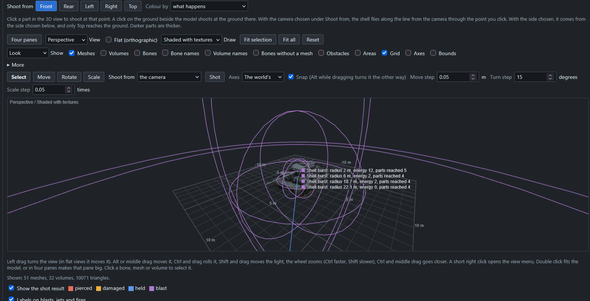
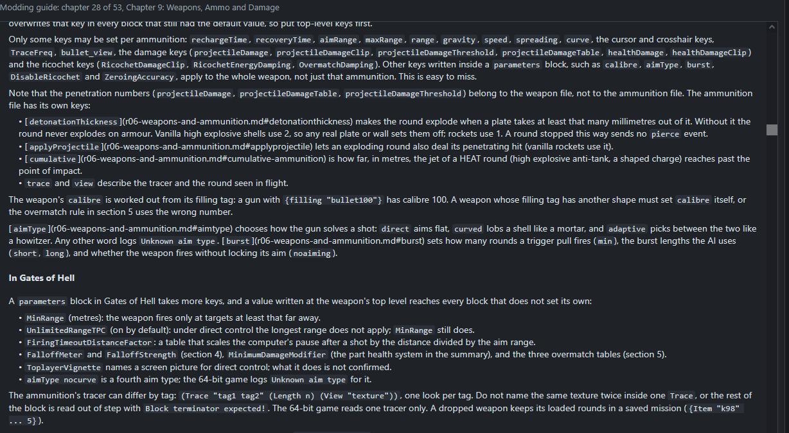
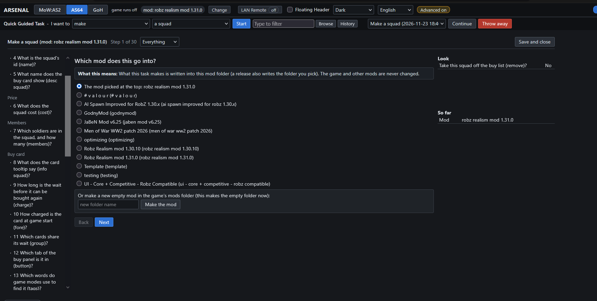
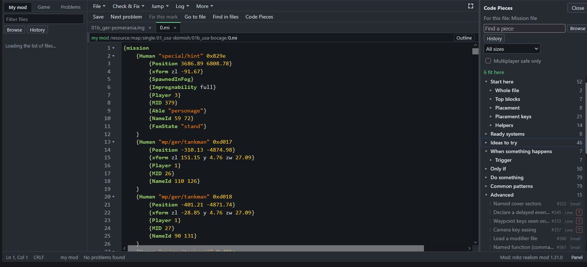
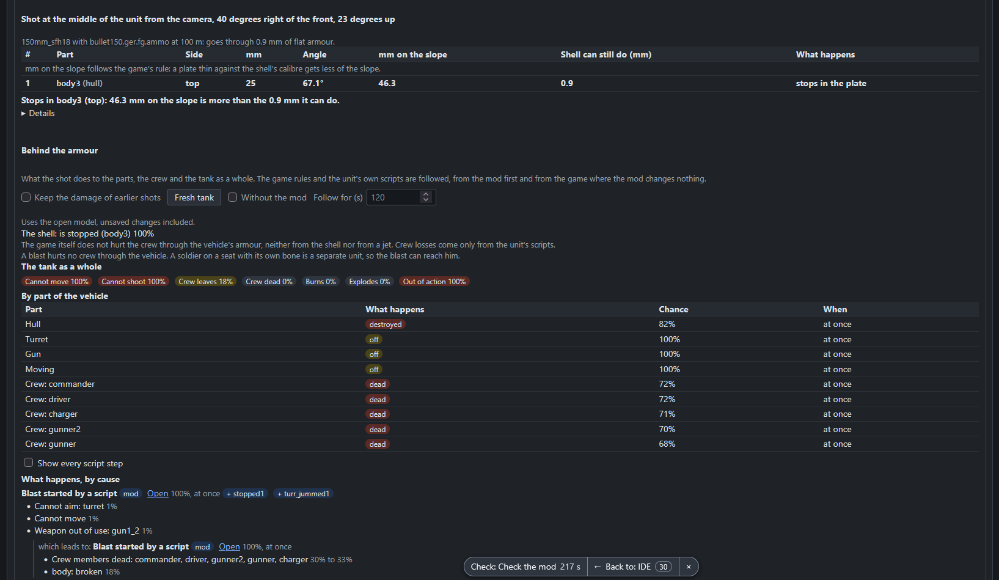
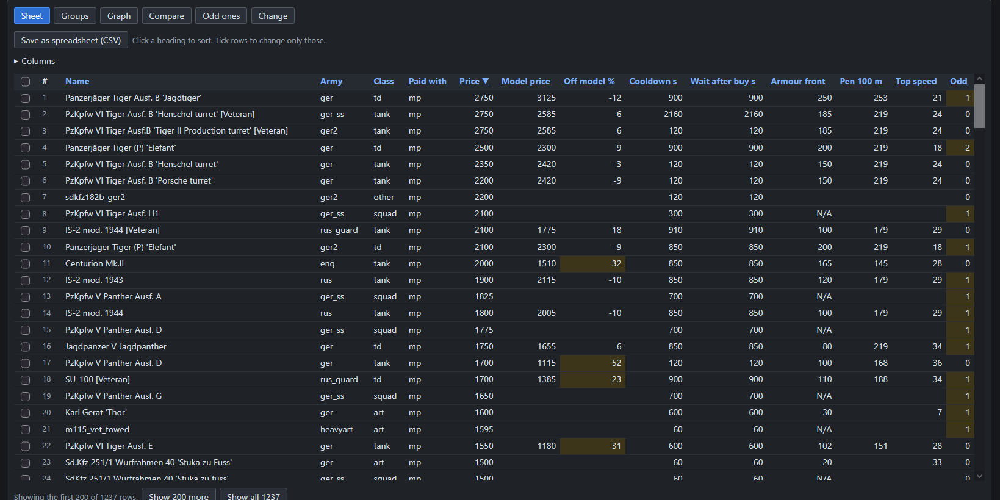
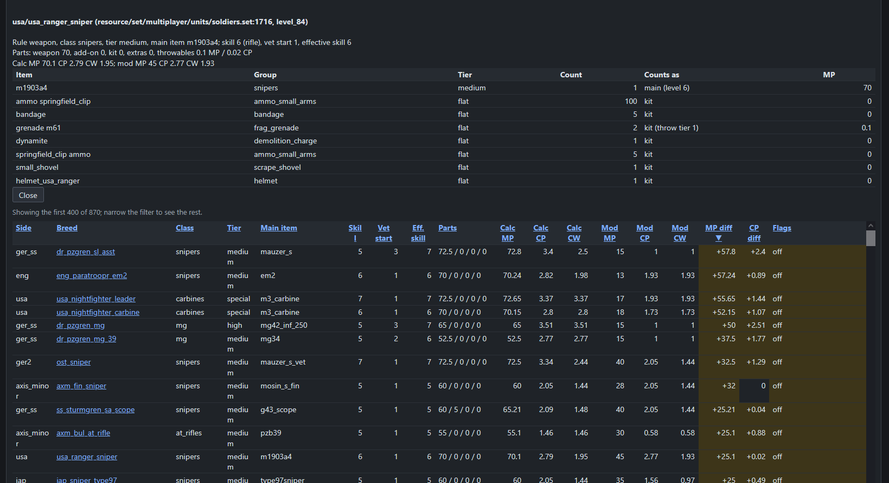
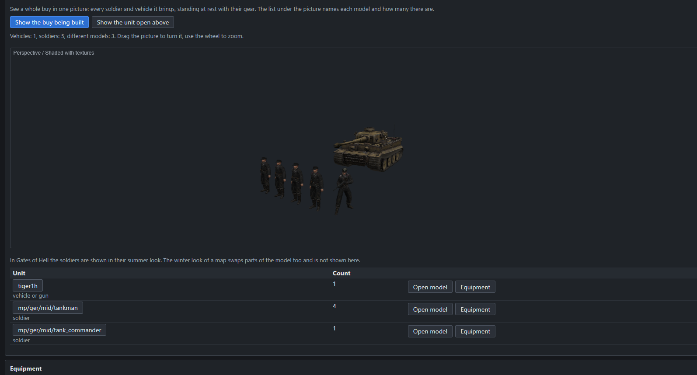
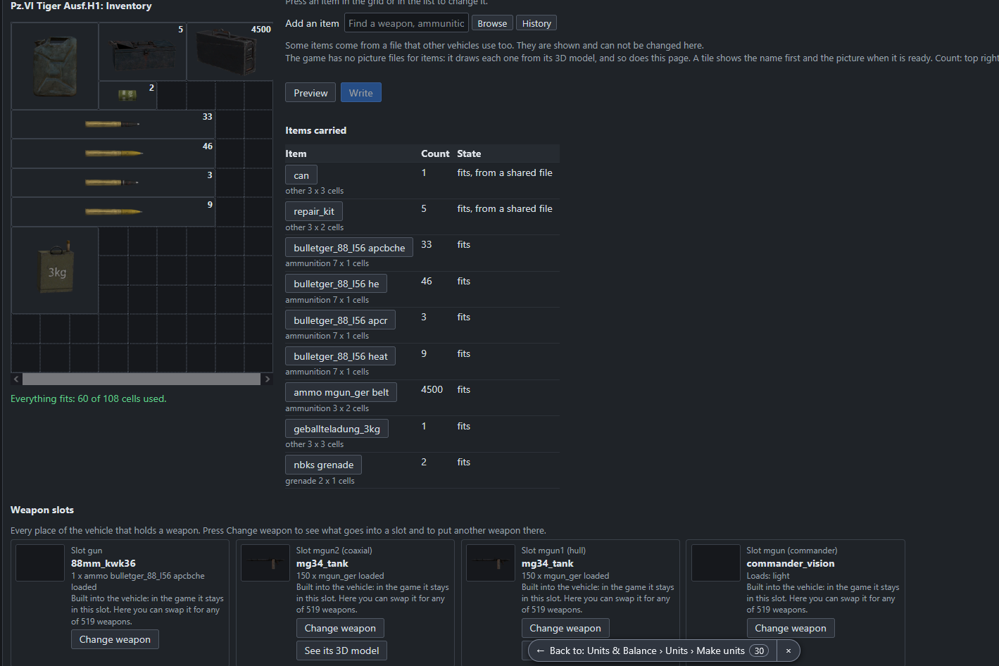

# ARSENAL

[English](README.md) | [Русский](README.ru.md) | **Українська** | [中文](README.zh.md)

A.R.S.E.N.A.L (All-in-one Resource SDK for Engine Assets & Levels): інструменти для створення модів до Men of War: Assault Squad 2, її 64-бітної збірки AS64 та Gates of Hell.

Це сторонній інструмент, створений переважно за допомогою ШІ. Використовуйте на власний ризик.

**Відкрита бета - триває активна розробка**



## Можливості

### Інформація без обмежень

- Найповніша документація з модингу з усіх, що виходили для рушія GEM.
- Каталог із десятків інструментів спільноти.
- 9000 проіндексованих посібників і запитань спільноти за десятиліття.
- 1819 історичних технічних документів із перших і других рук від різних країн часів Другої світової війни. Зараз у добірці переважно наземне озброєння та доктрини.



### Легкий старт

- Система швидких завдань, з якою будь-хто може швидко й легко почати робити моди.



- Інтегроване середовище розробки (IDE): майже 1000 готових блоків коду, підсвічування синтаксису рушія, докладний пошук помилок, пошук у pak-файлах і файлах оригінальної гри, зокрема відомості про те, які файли було перезаписано.



### Неперевершений контроль якості

- Виправлення з підказками, а подекуди автоматичне, будь-яких проблем, які рушій пропустив би або на яких він би аварійно завершився.
- Виправлення з підказками конфліктних файлів, коли ввімкнено кілька модів.
- Автоматичне читання журналу гри.
- Автоматична пакетна перевірка сутностей.

### Інші робочі процеси з підказками

- Відтворення звуків в IDE точно так, як вони звучать у грі за будь-яких умов.
- Редактор моделей із вбудованим симулятором балістики та вибухів, який рахує точно так само, як гра. Враховує скрипти оригінальної гри та модів.



- Перегляд карт, стилізовані й автоматичні генератори прев'ю, інструменти оцінки балансу.
- Автоматичний генератор простих місій.
- Налаштування ігрових режимів.
- Логіка закупівель ШІ та модифікатори керування, які можна змінювати за оцінками історичних доктрин.
- ШІ вибору цілей без складнощів.
- Помічник зі складних скриптів місій, який допомагає ШІ навіть у мережевій грі.
- Набір інструментів для балансу юнітів у мережевій грі, зокрема ціна кожного бійця за його характеристиками та спорядженням.





- Генератор значків юнітів.
- Редаговані 3D-види покупок з їхнім спорядженням і спрощеною ймовірністю предметів.





- Порівняння версій.
- MCP-сервери та навички для Claude.

і багато іншого.

## Запуск

Потрібен Node.js 18 або новіший; інсталятор налаштовує його сам. Інсталятор і вікно програми працюють англійською, російською, українською та китайською мовами; інсталятор сам вибирає мову системи. Теки ігор відкриваються лише для читання; інструменти пишуть лише в теку мода, яку ви назвете.

```bash
node tools/gui/gui.js
```

Потім відкрийте адресу, яку буде виведено.

## Що є в репозиторії

- `tools/` інструменти на node: перевірка, створення модів, перенесення, пакування, цикл тестування. Почніть із `tools/QUICKSTART.md`.
- `tools/gui/` вікно ARSENAL.
- `tools/mcp/` MCP-сервери для Claude (`.mcp.json`), `.claude/skills/` навички, які спрямовують завдання до потрібних інструментів.
- `tools/dist/`, `tools/installer/` збирають пакет для завантаження та інсталятори для Windows, Linux і macOS. Почніть із `BUILDING.md`; усі параметри описано в `tools/dist/README.md`.
- `guide/` посібник з модингу.
- `ww2sources/` історичні документи, у яких шукає вікно програми.

## Ліцензія

Apache License 2.0, див. `LICENSE`, `NOTICE` і `LICENSING.md`. Подяки: `CREDITS.md`. Назви ігор та ігрові дані належать їхнім власникам. Моди на зображеннях належать їхнім авторам.
