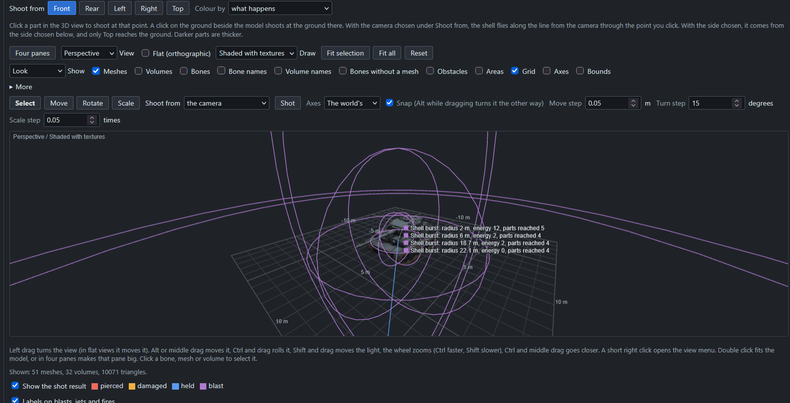
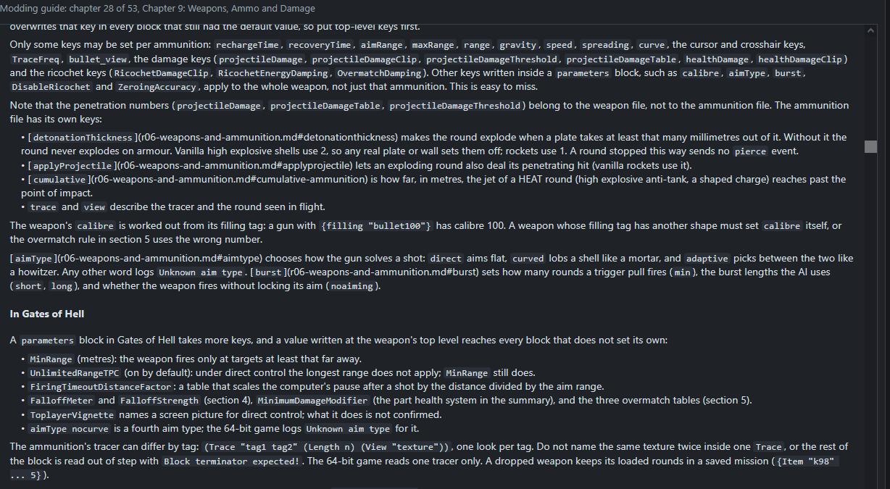
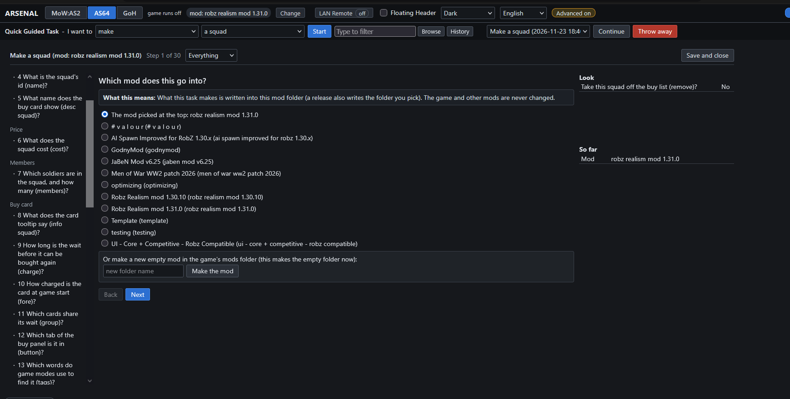
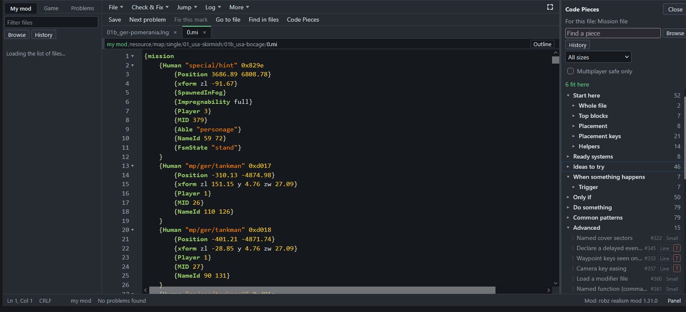
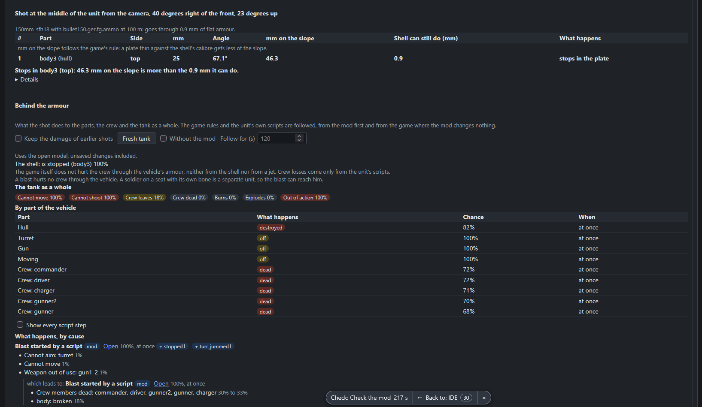
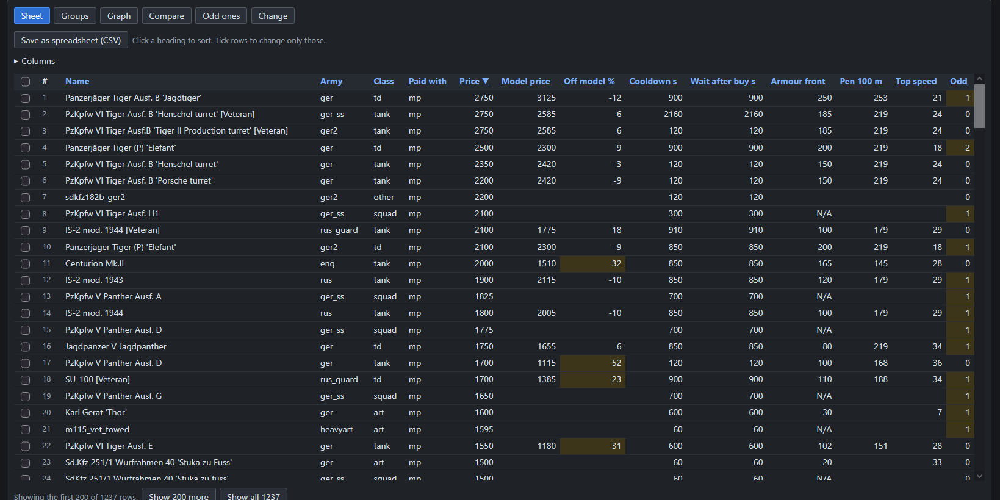
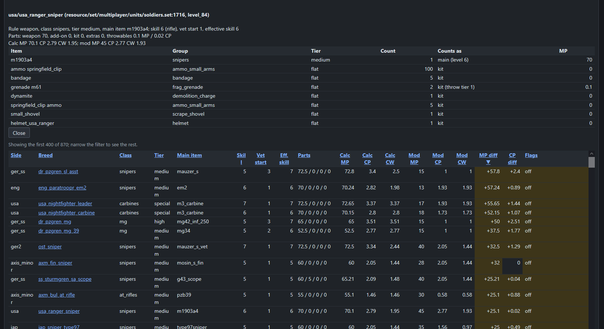
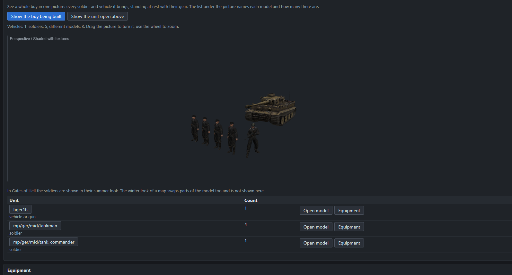
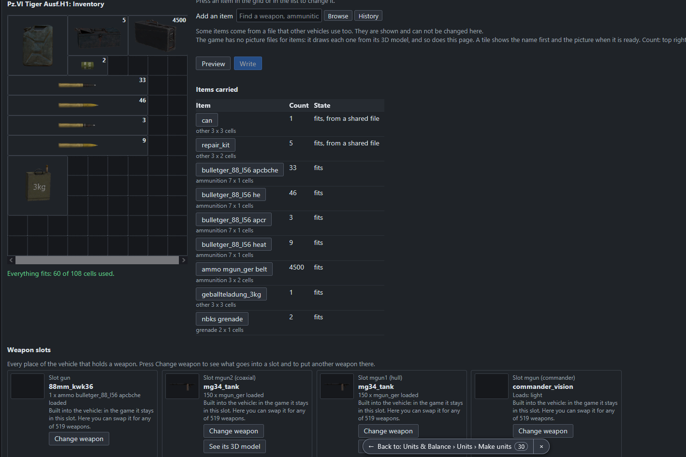

# ARSENAL

[English](README.md) | [Русский](README.ru.md) | [Українська](README.uk.md) | **中文**

A.R.S.E.N.A.L (All-in-one Resource SDK for Engine Assets & Levels)：适用于 Men of War: Assault Squad 2（战争之人：突击小队 2）、其 64 位版本 AS64 以及 Gates of Hell 的模组制作工具。

这是一个第三方工具，主要借助 AI 制作。使用风险自负。

**公开测试版 - 正在积极开发**



## 功能

### 信息全面开放

- GEM 引擎有史以来最全面的模组制作文档。
- 收录了数十个社区工具。
- 9000 篇已建立索引的社区指南和问答，跨越数十年。
- 1819 份来自第二次世界大战各国的一手和二手历史技术文献。目前主要是陆战武器和作战条令。



### 轻松上手

- 快速任务系统，让任何人都能快速、轻松地开始制作模组。



- 集成开发环境 (IDE)：近 1000 个预先排好格式的代码块、引擎专用的语法高亮、全面的错误检查、pak 文件和原版文件搜索，并能显示哪些文件被覆盖。



### 无与伦比的质量控制

- 对引擎会忽略或导致崩溃的各种问题进行辅助修复，部分可自动修复。
- 启用多个模组时，辅助修复相互冲突的文件。
- 自动读取日志。
- 批量自动测试实体。

### 其他辅助工作流程

- 在 IDE 中播放声音，与游戏中任何条件下的效果完全一致。
- 模型调整器，内置弹道与爆炸模拟器，计算方式与游戏完全一致。同样支持原版和模组的脚本。



- 地图查看器、风格化和自动的预览图生成器、平衡评估工具。
- 自动基础任务生成器。
- 游戏模式调整器。
- AI 购买逻辑和控制修正，可根据历史作战条令评估进行修改。
- 让目标选择 AI 变得简单。
- 高级任务脚本助手，即使在多人游戏中也能帮助 AI。
- 多人游戏单位平衡工具包，包括根据属性和装备为每个兵种定价。





- 单位图标生成器。
- 可编辑的 3D 购买单位视图，包含其装备和简化的物品概率。





- 版本差异检查器。
- Claude MCP 和技能。

以及更多功能。

## 开始使用

需要 Node.js 18 或更新的版本；安装程序会自行设置。安装程序和窗口提供英语、俄语、乌克兰语和中文；安装程序会自动选用系统语言。游戏安装目录只读；工具只写入您指定的模组文件夹。

```bash
node tools/gui/gui.js
```

然后打开它显示的地址。

## 仓库内容

- `tools/` node 工具：检查器、模组创建、移植、打包、测试循环。请从 `tools/QUICKSTART.md` 开始。
- `tools/gui/` ARSENAL 窗口。
- `tools/mcp/` 供 Claude 使用的 MCP 服务器 (`.mcp.json`)，`.claude/skills/` 把任务引导到相应工具的技能。
- `tools/dist/`、`tools/installer/` 用于构建下载包以及 Windows、Linux 和 macOS 的安装程序。请从 `BUILDING.md` 开始；所有选项见 `tools/dist/README.md`。
- `guide/` 模组制作指南。
- `ww2sources/` 窗口可搜索的历史文献。

## 许可证

Apache License 2.0，见 `LICENSE`、`NOTICE` 和 `LICENSING.md`。致谢：`CREDITS.md`。游戏名称和游戏数据归其所有者所有。图片中出现的模组归其作者所有。
